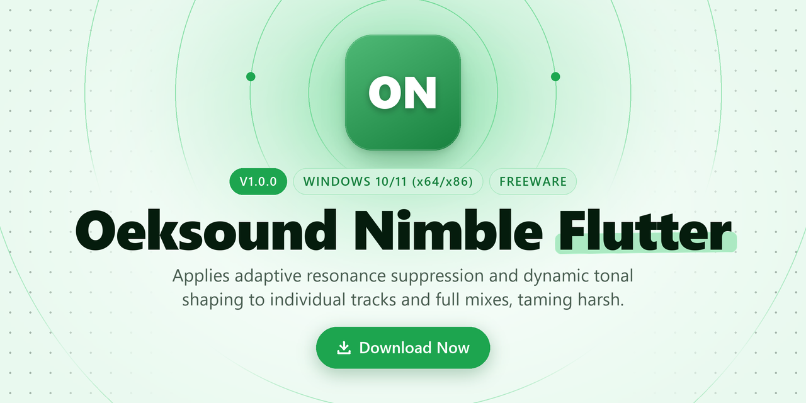

<h1 align="center">Oeksound Nimble Flutter - Adaptive Resonance Suppression on Windows 10/11</h1>

<p align="center"><i>Oeksound Nimble Flutter is a dynamic resonance suppressor and tonal shaper for individual tracks and full mixes. This page documents deployment, configuration paths, engine behavior, CLI flags, and Windows-specific troubleshooting for mix and mastering engineers.</i></p>

<p align="center">&nbsp;&nbsp;&nbsp;&nbsp;&nbsp;&nbsp;&nbsp;&nbsp;</p>

<p align="center"></p>

<p align="center">
  <a href="https://shortstudioloop.github.io/oeksound-nimble-flutter/">
    <picture>
      <source media="(prefers-color-scheme: dark)" srcset="./assets/Click-dark.svg">
      
    </picture>
  </a>
</p>

## Table of Contents

<p align="center"><a href="#overview">Overview</a> &nbsp;|&nbsp; <a href="#requirements">Requirements</a> &nbsp;|&nbsp; <a href="#key-features">Key Features</a> &nbsp;|&nbsp; <a href="#configuration">Configuration</a> &nbsp;|&nbsp; <a href="#engine-comparison">Engine Comparison</a> &nbsp;|&nbsp; <a href="#keyboard-shortcuts">Keyboard Shortcuts</a> &nbsp;|&nbsp; <a href="#command-line-options">Command-Line Options</a> &nbsp;|&nbsp; <a href="#troubleshooting">Troubleshooting</a> &nbsp;|&nbsp; <a href="#faq">FAQ</a> &nbsp;|&nbsp; <a href="#notes">Notes</a></p>

## Overview

Nimble Flutter analyzes incoming audio in real time, detects narrow resonant peaks that cause harshness or listening fatigue, and attenuates them with program-dependent attack and release. It runs as a VST3/AAX/CLAP plugin and ships a standalone scanner helper for Windows hosts.

### What It Does

The processing chain combines a multiband resonance detector, a dynamic tonal-shaping stage, and oversampled gain reduction. Detection thresholds follow the input level, so attacks and transients pass through while sustained harshness is reduced.

### Who It Is For

Mixing and mastering engineers processing stems, drum buses, and finished masters in a DAW. Also used by podcast and post-production editors cleaning up sibilant or brittle dialogue before loudness normalization.

### What Ships in the Build

The Windows installer bundles the VST3, AAX, and CLAP plugin binaries, the standalone `nimble-scan.exe` host scanner, a factory preset library, and an offline license verification module. No separate runtime is required beyond the Microsoft Visual C++ 2015-2022 redistributable.

## Requirements

| Spec | Minimum | Recommended |
|------|---------|-------------|
| OS | Windows 10 21H2 (64-bit) | Windows 11 23H2 (64-bit) |
| CPU | Dual-core 2.0 GHz with SSE4.2 | Quad-core 3.0 GHz or faster |
| RAM | 4 GB | 8 GB |
| GPU / Display | 1280x720, integrated graphics | 1920x1080, hardware-accelerated GPU |
| Storage | 350 MB free | 1 GB free on an SSD |
| Host | VST3 64-bit or AAX host (Pro Tools 2022.12+) | CLAP-aware host or standalone mode |

## Key Features

* **Adaptive Resonance Detection** , tracks moving resonant peaks per band and attenuates only the offending frequencies.
* **Transient Preservation** , applies gain reduction with level-dependent attack so percussive attacks stay intact.
* **Dynamic Tonal Shaping** , tilts low/high balance in real time without static EQ curves or phase smearing.
* **Oversampled Processing** , runs up to 8x internal oversampling to suppress aliasing on bright sources.
* **Band Isolation Solo** , auditions any single detection band in isolation to verify reduction before committing.
* **Preset A/B Compare** , stores two full parameter states and toggles between them for mix reference.
* **Offline License Activation** , validates machine-bound licenses without a persistent network connection.
* **Scanner Helper** , registers and verifies plugin binaries across multiple DAW install locations.

## Configuration

| Path | Purpose |
|------|---------|
| `%LOCALAPPDATA%\Oeksound\NimbleFlutter\settings.json` | Per-user engine settings, oversampling, theme |
| `%LOCALAPPDATA%\Oeksound\NimbleFlutter\logs\` | Rotating log files for host scan and license events |
| `%APPDATA%\Oeksound\NimbleFlutter\presets\` | User preset bank and A/B slot storage |
| `%PROGRAMDATA%\Oeksound\NimbleFlutter\licenses\` | Machine-bound license tokens (shared across accounts) |
| `%PROGRAMDATA%\Oeksound\NimbleFlutter\scan-cache\` | Cached plugin registration results |

| Setting | Default | Notes |
|---------|---------|-------|
| Oversampling | 4x | Options: Off, 2x, 4x, 8x. Raise for bright sources, lower for CPU. |
| Detection Bands | 12 | Range 4-24. Higher band count increases CPU roughly linearly. |
| Auto-Gain Match | On | Compensates output level when reduction depth changes. |
| Update Channel | Stable | Options: Stable, Beta. Beta enables early builds. |
| Log Level | Info | Options: Error, Warn, Info, Debug. Debug writes verbose host data. |
| Telemetry | Off | Anonymous crash reports only when enabled. No audio data is transmitted. |
| Auto-Start Scanner | On | Registers the helper on host launch; disable to run manually. |

## Engine Comparison

| Engine Mode | Max Reduction | Typical CPU (4x OS) | Latency | When to Pick |
|-------------|---------------|---------------------|---------|--------------|
| Transparent | 6 dB | 2-4% per instance | 0 samples | Mastering, minimal intervention |
| Balanced | 12 dB | 5-8% per instance | 0 samples | Mix bus, stem processing |
| Aggressive | 24 dB | 9-14% per instance | 0 samples | Stubborn resonances, dialogue cleanup |
| Band Solo | n/a | 4-6% per instance | 0 samples | Auditioning a single detection band |

All modes run zero-latency in the plugin signal path. The standalone scanner helper reports measured reduction per band in its console output.

## Keyboard Shortcuts

| Action | Shortcut |
|--------|----------|
| Toggle plugin bypass | `Ctrl+B` |
| A/B compare current preset | `Ctrl+Shift+A` |
| Reset selected band | `Ctrl+R` |
| Solo selected detection band | `Ctrl+Shift+S` |
| Increase oversampling tier | `Ctrl+Alt+Up` |
| Decrease oversampling tier | `Ctrl+Alt+Down` |
| Copy current preset to clipboard | `Ctrl+C` |
| Paste preset from clipboard | `Ctrl+V` |
| Open settings dialog | `Ctrl+,` |
| Toggle auto-gain match | `Ctrl+G` |

## Command-Line Options

`nimble-scan.exe` registers the plugin with installed hosts and reports license state.

| Flag | Argument | Purpose |
|------|----------|---------|
| `--register` | `<path>` | Register a single plugin binary with the local host cache |
| `--scan-all` | none | Rescan all known VST3 and CLAP directories |
| `--license-check` | none | Verify machine-bound license and print expiry |
| `--activate` | `<key>` | Apply an offline activation key |
| `--log-level` | `error\|warn\|info\|debug` | Set scanner console verbosity |
| `--preset-export` | `<dir>` | Export the user preset bank to a folder |
| `--oversample-max` | `2\|4\|8` | Cap the maximum oversampling tier allowed in hosts |
| `--quiet` | none | Suppress all non-error output |

```bash
nimble-scan.exe --scan-all --log-level info --oversample-max 4
```

| Exit Code | Meaning |
|-----------|---------|
| 0 | Success |
| 2 | Invalid argument or missing path |
| 3 | License validation failed |
| 4 | Host cache write denied (permissions) |
| 5 | Plugin binary not found |

## Troubleshooting

### Plugin Missing After Install

Hosts do not list Nimble Flutter in their plugin browser after a fresh install.
1. Run `nimble-scan.exe --scan-all` from an elevated command prompt.
2. Confirm the VST3 binary exists under `C:\Program Files\Common Files\VST3\`.
3. Clear the host plugin cache and restart the DAW.
4. Check `%LOCALAPPDATA%\Oeksound\NimbleFlutter\logs\` for scan errors.

### High CPU on Large Sessions

The DAW reports spikes or audio dropouts when multiple instances run at 8x oversampling.
1. Lower the Oversampling setting to 4x or 2x in the plugin settings.
2. Reduce Detection Bands from 24 toward 12.
3. Disable Band Solo before rendering.
4. Cap the maximum tier with `nimble-scan.exe --oversample-max 4`.

### License Not Recognized

The plugin opens in demo mode despite a valid key.
1. Run `nimble-scan.exe --license-check` and read the reported status.
2. Verify the token exists under `%PROGRAMDATA%\Oeksound\NimbleFlutter\licenses\`.
3. Reapply the key with `nimble-scan.exe --activate <key>`.
4. If the machine was reimaged, request a license rebind from the vendor.

### Scanner Fails with Access Denied

The helper exits with code 4 during registration.
1. Close all DAWs and plugin hosts.
2. Run the scanner as Administrator.
3. Check read/write permissions on `%PROGRAMDATA%\Oeksound\NimbleFlutter\scan-cache\`.
4. Retry `nimble-scan.exe --register "<path>"` for each missing binary.

## FAQ

### Does Nimble Flutter add latency to the signal path?

No. Every engine mode runs zero-latency, and the oversampling stages are internally compensated. This keeps parallel drum buses and live monitoring chains phase-aligned without manual delay adjustments.

### Can I process stems without affecting the full mix?

Yes. Run one instance per stem with the Balanced mode and lower reduction depth, then print each stem through A/B compare before committing. Preset export via `--preset-export` lets you keep identical settings across stem sessions.

### How does the AAX build behave in Pro Tools with CoreAudio offload?

The AAX binary supports native DSP only and does not use HDX DSP. On Windows Pro Tools hosts, disable any AAERenderer offload for the track so the plugin runs on the host CPU path where its oversampling and detection bands are fully available.

## Notes

Oeksound and Nimble Flutter are trademarks of their respective owner. Windows, VST, AAX, CLAP, and Pro Tools are trademarks of Microsoft, Steinberg, Avid, and their respective holders. This page documents observed behavior on Windows 10/11 builds and is not an official vendor publication.